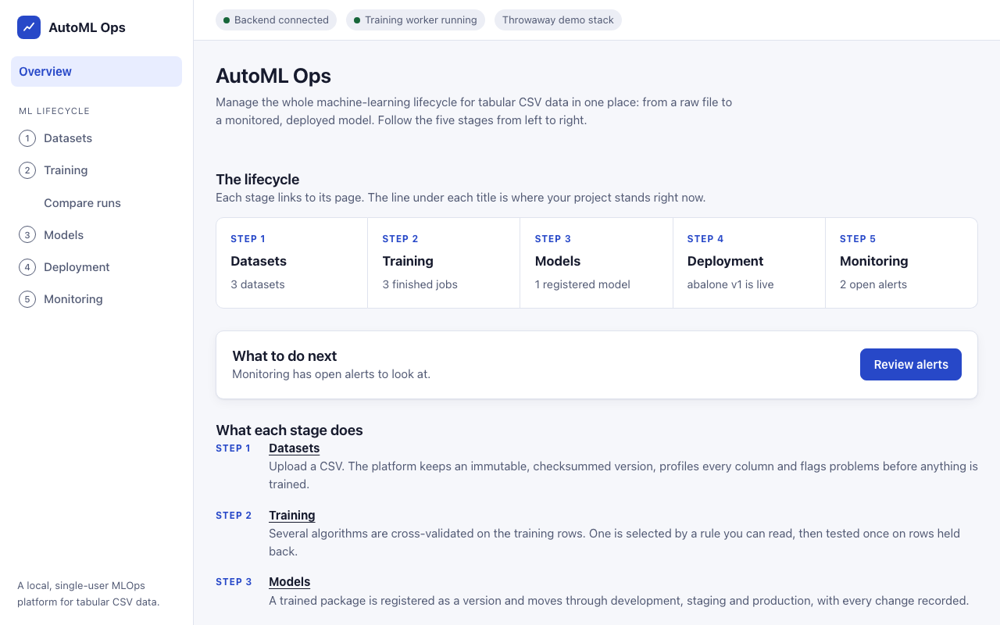
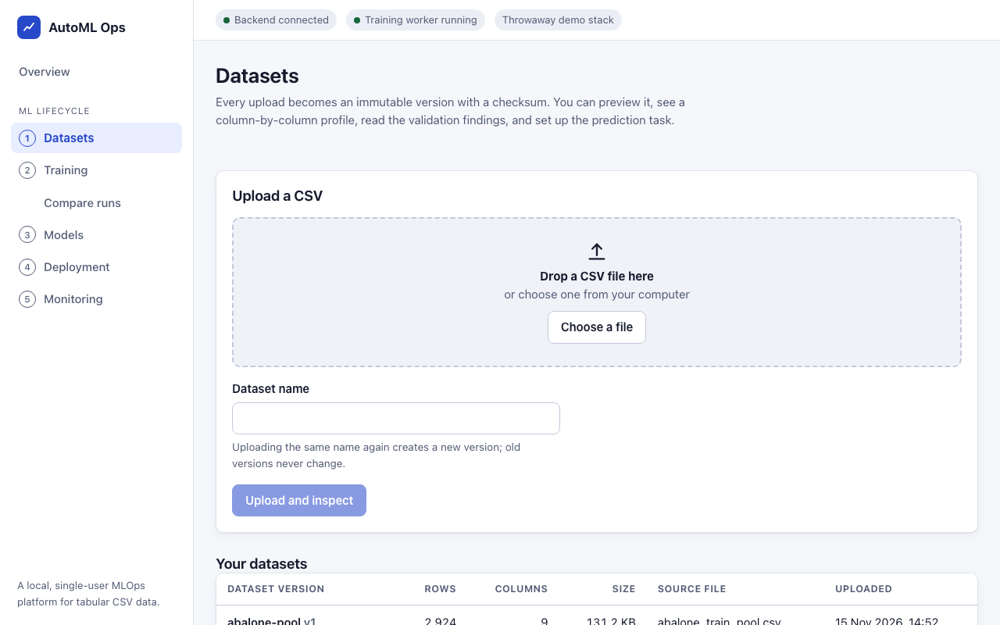
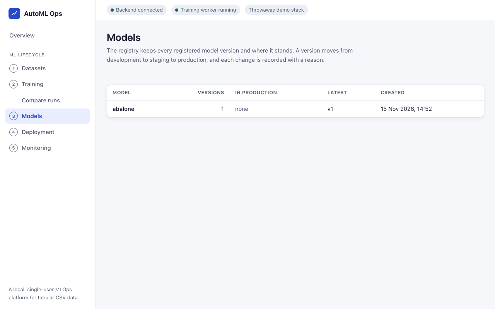
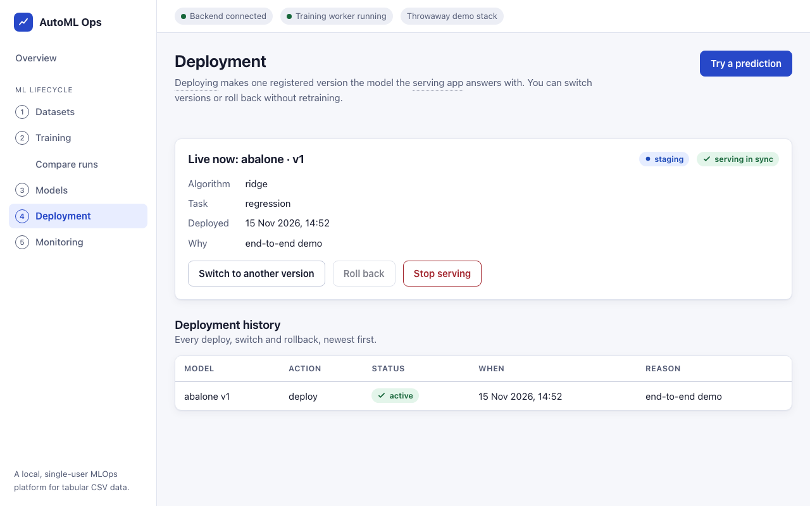
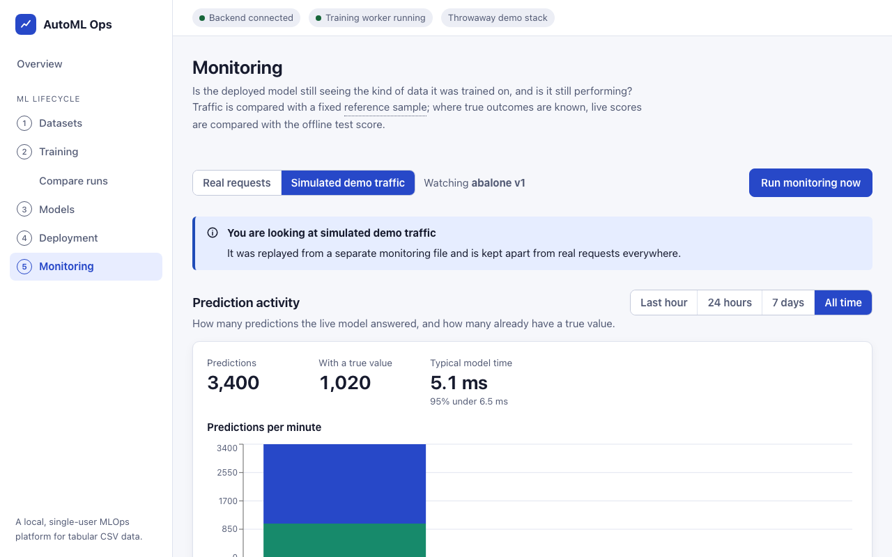

# AutoML Ops

A single-user, local platform that manages the machine learning lifecycle for tabular CSV data: dataset
validation, training with cross-validation, experiment tracking (MLflow), a model registry, REST deployment,
live feedback and drift monitoring with alerts. Solo portfolio project. Scope: [SCOPE.md](SCOPE.md).
Local only, no authentication, not production-ready.

## Status

Built and verified: dataset ingestion, profiling and validation; task configuration; training, selection, one
final test and sealed model packages; MLflow tracking; PostgreSQL database and migrations; control-plane API;
training jobs with a worker; model registry with an optional MLflow mirror; serving app and deployments;
feedback and live performance; drift monitoring, reference samples and alerts; the traffic simulator and an
end-to-end script; the web frontend (owner-reviewed); a full local Docker Compose stack
([docs/compose.md](docs/compose.md)); and CI workflow files.

**Not verified, stated plainly:** the GitHub Actions workflow has never run on GitHub (it was only
syntax-checked locally), so no CI result exists. Everything was run on one machine (Apple-silicon Mac, Docker
Desktop); Linux, x86-64 and Windows were not run. Nothing is deployed to a hosted service and none is planned:
"deployment" here means the serving app on 127.0.0.1. Known limits: [docs/simulator.md](docs/simulator.md#limits),
[docs/monitoring.md](docs/monitoring.md#limits) and the list at the end of this page.

## Architecture

```
 browser ──► UI (nginx, static)                    CSV files ──► upload
    │                                                                │
    ├────────────────────► control-plane API :8100 ◄─────────────────┘
    │                       │  datasets · jobs · registry · deployments · monitoring · alerts
    │                       ├──► PostgreSQL (authoritative: catalog, jobs, registry, deployments,
    │                       │                predictions, feedback, alerts)
    │                       └──► tells the serving app to reload on a deployment change
    │                                                   │
    │                       worker (one job at a time) ─┤ reads the dataset store, trains with
    │                        └─► MLflow tracking (SQLite) │ cross-validation, seals model packages
    │                                                   ▼
    └────────────────────► serving app :8200 ──► loads the one deployed, hash-checked package
                            POST /predict · /feedback   (never imports MLflow or the control plane)
```

The control plane and the serving app are separate applications, so the serving image carries no MLflow.
Design notes: [docs/registry.md](docs/registry.md), [docs/serving.md](docs/serving.md),
[docs/monitoring.md](docs/monitoring.md).

## The demo in three stages

Reproducing the whole demo needs these three stages, in order. Nothing is deployed anywhere.

1. **Prepare the demo data once** (downloads the UCI files only if `data/raw/` lacks them):
   `make demo-data`
2. **Start the services** (Docker Compose, services only; it prepares no data and runs no workflow):
   `make full-env` (once), then `make full-up`
3. **Run the workflow**, either `make e2e-compose` (upload, train, register, promote, deploy, predict, drift
   alert) or open <http://localhost:25173> and do the same by hand. `make full-down` stops it.

Details, ports, memory limits and the measured start-up time: [docs/compose.md](docs/compose.md).
Prefer no containers? The commands under "Run it" below start the same services with `uv run`.

## Screenshots

Captured with Playwright from `make ui-demo` (a throwaway backend with seeded demo and simulated traffic; the
header says so), 1280 x 800, light theme. They show the real UI, not mock-ups.

| Overview | Datasets |
| --- | --- |
|  |  |
| **Models** | **Deployment** |
|  |  |



## Setup

Requires [uv](https://docs.astral.sh/uv/), Python 3.12 and Docker (for PostgreSQL).

```bash
uv sync                                  # environment and dependencies from the lockfile
cp .env.example .env                     # then set POSTGRES_PASSWORD
make db-up                               # PostgreSQL on 127.0.0.1:55432
uv run python scripts/db.py upgrade      # apply migrations (you run this; nothing else does)
make demo-data                           # one-time: downloads the UCI data only if data/raw/ lacks it
make check                               # lint, type-check and the whole test suite
```

## Run it

Four terminals (all bind to 127.0.0.1):

```bash
make api       # control plane, :8100      (datasets, jobs, registry, deployments, monitoring, alerts)
make serve     # serving app, :8200        (POST /predict, /feedback; serves the active deployment)
make worker    # trains jobs one at a time (set AUTOML_JOBS_MLFLOW_DIR for tracked jobs)
make e2e       # the backend story on the Abalone demo data, on a THROWAWAY stack it makes and removes
```

`make e2e` (`scripts/e2e_isolated.py`, then `scripts/e2e_demo.py`) creates a throwaway database
(`automl_test_e2e_<random>`) and temporary folders outside the project, starts the API, serving app and worker
on free local ports, uploads the training pool, trains and tracks a final job, registers, promotes and deploys
the model, then replays the monitoring stream as simulated traffic (normal, shifted, normal) with feedback and
monitoring after each phase, and removes only what it created. **It never uses the normal `automl_ops` or
`mlflow` databases or `data/`**: the story script refuses, before any write, to run unless both services report
an isolated stack (see [docs/simulator.md](docs/simulator.md)). `make simulate` replays traffic against an
already deployed model and does write to that stack.

## The web UI

```
make ui-install   # once: npm ci in frontend/
make ui-dev       # http://localhost:5173 (needs make api, make serve, make worker)
make ui-demo      # a THROWAWAY seeded backend plus the UI; removed on Ctrl-C, your data is not used
```

Six screens follow the lifecycle: Datasets, Training (with experiment comparison), Models, Deployment (with a
prediction form), Monitoring (activity, live performance, drift reports, alerts, feedback). See
[docs/frontend.md](docs/frontend.md) and [frontend/README.md](frontend/README.md).

## Documentation

[docs/api.md](docs/api.md) (control plane) · [docs/serving.md](docs/serving.md) ·
[docs/monitoring.md](docs/monitoring.md) · [docs/registry.md](docs/registry.md) ·
[docs/jobs.md](docs/jobs.md) · [docs/tracking.md](docs/tracking.md) · [docs/database.md](docs/database.md) ·
[docs/data.md](docs/data.md) (data sources, licences, the synthetic shifted copies) ·
[docs/simulator.md](docs/simulator.md) · [docs/compose.md](docs/compose.md) (the Docker stack). OpenAPI files: `docs/openapi-control.json`,
`docs/openapi-serving.json` (`make openapi`; a test fails if they are stale).

## Things to know

- The held-out test part is read once per job, for the selected model only; reuse across jobs is an **open
  decision**, so every reported test result carries that limitation.
- Monitoring uses numpy-only statistics (Evidently was not installed) and runs on demand. The performance
  alert scores the labels inside the same 1,000-prediction window as drift, so it recovers with the traffic.
- **Known limitation: no retention.** Predictions, labels, monitoring reports and alerts are kept forever and
  grow without limit; there is no pruning or archiving job.
- Simulated traffic is always labelled simulated and is kept apart from real traffic.
- Drift means "inputs differ from training data", not "the model is wrong".
- Data, models, MLflow runs and secrets are never committed.
- Demo datasets (UCI Adult and Abalone) are small and openly licensed (CC BY 4.0, checked at Step 2; sources and
  attribution in [docs/data.md](docs/data.md)); drift demos use labelled synthetic shifts. This is not legal advice.
- Monitoring data is separate: the traffic simulator and its shifted copy use a disjoint monitoring stream, never
  rows used for training, cross-validation, selection or the final test.
- The Docker stack is local delivery only: single user, no authentication, localhost only. It is not a
  production deployment, and no hosted deployment exists or is planned.
- Compose stack, tested: a process exit in the API, serving or worker container is restarted by Docker and
  serving stays reachable ([docs/compose.md](docs/compose.md#limits-and-what-has-not-been-tested)). Not
  tested: out-of-memory kills, daemon restarts, other hosts. The GitHub Actions workflow has never run.
- The reproducibility check (`scripts/datasets.py reproduce`) and the MLflow-mirror reconcile
  (`scripts/registry.py reconcile`, `POST /models/{name}/reconcile`) are script/API only in Version 1, not in the UI.
